# Twin-city art implementation

Started 17 November 2026 on `feat/twin-city-art`, based on `c725809`.
Previous twin-city PR [#260](https://github.com/lordlebu/4000BCESaraswathy/pull/260)
is merged; its head `57fcfa6` is an ancestor of the base.

## First review slice

- Preferred painted editions resolve through the actual portrait, place and event callers.
- Existing originals and seeded event-take behavior are preserved as fallbacks.
- Eru receives a distinct 256×256 portrait.
- The Shaded Courtyard receives a 768×336 place painting and a 512×384 event painting.
- A dedicated 192×192 neem, exposed root ring and jars replace its palm marker.
- Adjacent house stamps are cleared beneath the canopy. A shaded bed, basin and rubble
  occupy eligible dry settlement ground beside it, avoiding roads and rails.
- Geometry and saved-world data are unchanged; scenery is composed from the restored POI anchor.

The NPC walking sheets, compound architecture, terrain and road pass, wider river and cliff
work, and terminal animation are pending in the [execution plan](twin-cities-art-plan.md).
The notebook figure in the event painting is a courtyard visitor, not a redesign of Varuna.

## Rebuild

These four source PNGs are retained in the checkout. Explicit ignore exceptions retain the
three pilot UI sources alongside their delivery assets, making the pilot reproducible.

```text
node tools/build-twin-courtyard.js
node tools/build-plates.js --portraits --only=twin-mason-painted --force
node tools/build-plates.js --places --only=poi_harappa_court-painted --force
node tools/build-plates.js --events --only=happening_twin_courtyard-painted --force
```

The UI builder uses its existing crop, resampling and encoding pipeline. The neem builder
samples its transparent source onto a 96-pixel grid and doubles with nearest-neighbor sampling.
Accepted earlier sheets are not rebuilt or modified.

## Verification of this batch

- Typecheck passed.
- Full unit suite: 160 files, 3,585 tests passed.
- All 13 targeted twin-city browser cases passed, including the three new art cases.
- The three new art cases also passed against a production build served at the Pages subpath
  `/4000BCESaraswathy/`, covering desktop, touch mobile and Eru's conversation.
- Production build, canon lock and bundle size checks passed. The subpath app measured
  212.9 KB gzipped against the unchanged 220 KB budget.
- All four delivery assets reproduced byte-for-byte from their retained sources.
- Temporarily disabling preferred-edition lookup made the new selection guard fail on Eru's
  original portrait. Restoring the lookup returned all twelve art-registry tests to green.
- Actual desktop and mobile captures were inspected for artwork, cropping and runtime errors.

The first portrait browser fixture assumed Eru was resident at noon. The page correctly said
he was on the road; the passing fixture now hails him through the normal talk action.
The full repository-wide browser suite and a player-hardware performance comparison have
not been run for this batch. The screenshot review still leaves the larger architecture
and scale pass pending.

## Review captures

Captures use the real Phaser scene with normal fog. Knowledge is seeded to unlock the
courtyard event; they are visual checks, not a claimed progression playthrough.

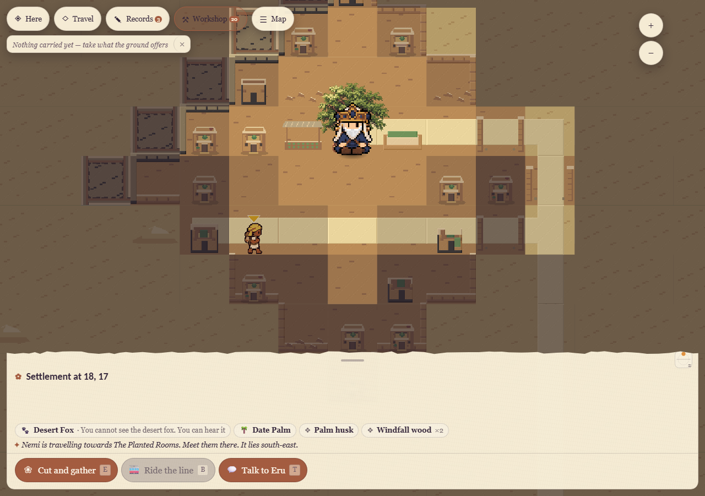
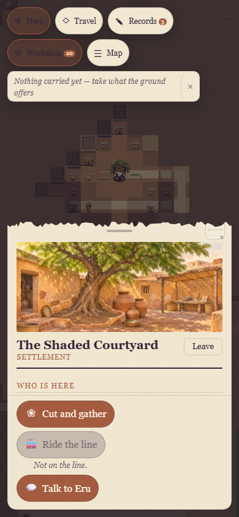
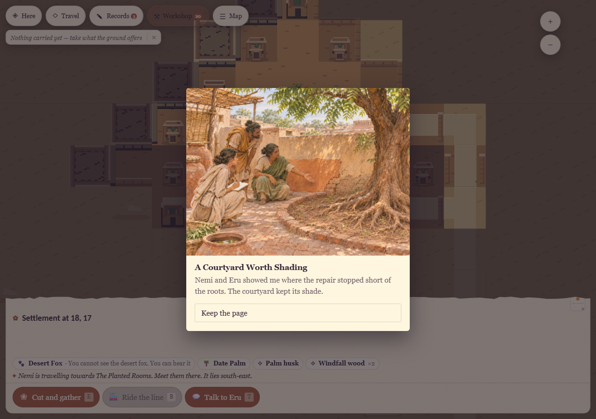
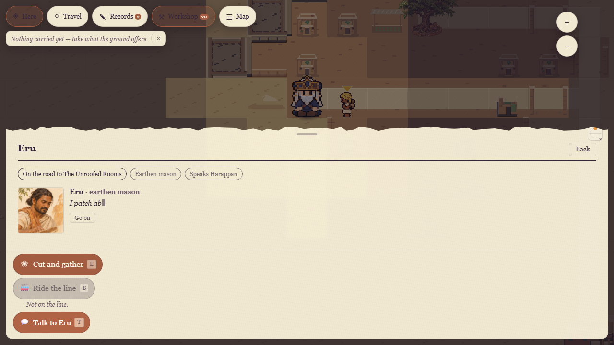

Local review:

```text
http://127.0.0.1:4173/?map=field_map_twins&seed=twin-art-review&hour=12&door=open&at=poi_harappa_court
```

## Second batch: material surfaces and drainage

- Added a separate four-frame material sheet: swept earthen forecourts, staggered fired-brick
  aprons, recessed wet drains with partial covers, and loose talus at desert/hill transitions.
- Overlays sit below row-sorted objects, keeping people, buildings and route surfaces readable.
- A five-tile drainage strip follows the restored drain-court anchor. Houses are kept off it;
  roads and rails retain their existing crossings and remain clear.
- Rock cliff rims no longer appear against river, sea or wetland neighbors. Water banks
  retain their separate edge treatment.
- Existing sheets remain intact. Rebuild the new sheet with `node tools/build-twin-surfaces.js`.

Verification: typecheck; nine twin-city unit cases, including surface placement and world
immutability; all four art browser cases (desktop, touch mobile, portrait, both city materials);
production build and size check. The updated drainage layout was recaptured after removing
the overlapping house stamps. The full unit suite has not been rerun for this second batch.
These are deterministic procedural material textures; no additional image generation was used.


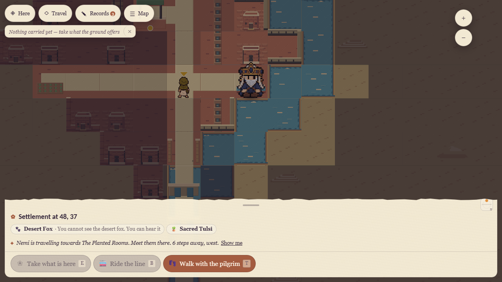

## Third batch: city-specific house silhouettes

Added two source-painted SNES building silhouettes using the built-in image generator:
an ochre plaster courtyard home for Harappa and a fired-brick home with a rooftop drying
court for Mohenjo-daro. [Exact prompts and source names](twin-house-prompts.md) are retained.

`node tools/build-twin-homes.js` reproduces `assets/twins/homes-painted.png` from the two
tracked sources in `assets/source/twins/`. It crops alpha bounds, fits the original aspect
ratio, aligns both bases and samples onto a two-pixel grid. The 128×144 frames contain
120×110 / 120×114 silhouettes, giving the new architecture more presence than the smaller
drawings inside the accepted 80×88 frames. There is no runtime scale transform.

Seeded placement mixes new silhouettes with both existing house sheets, using the correct
city frame. All eight original house frames still occur across the review seeds. Public
courtyard reservations, the drainage corridor, road and railway exclusions remain active.
World geometry, save data and POI anchors are unchanged.

The atlas reproduced byte-for-byte. Typecheck, all 3,586 unit tests, seven browser art/transport
checks, production build and unchanged bundle budget passed. Current root-build app chunk:
212.8 KB gzipped against 220 KB. Actual game captures were inspected. The remaining scale
variation between old and new homes, repeated adjacent new silhouettes, and compound grouping
are still part of the next architecture pass; this is not the final city composition.

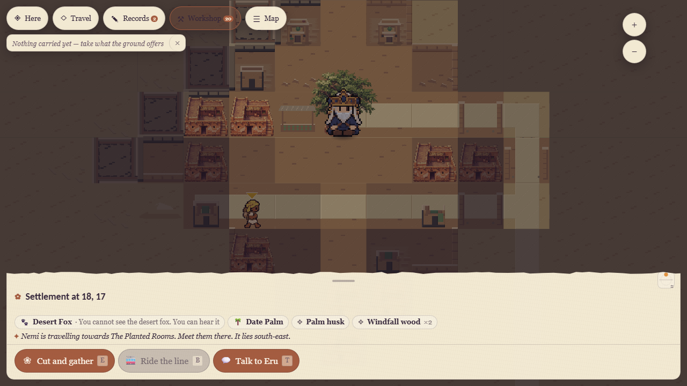
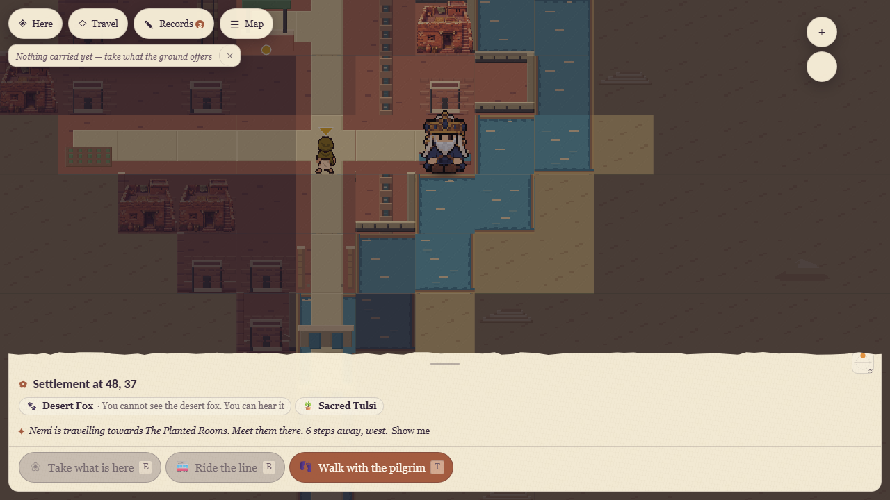

## Fourth batch: simpler SNES style and measured frame cost

The owner requested restrained detail and a performance check with the new houses applied.
The runtime now uses `assets/twins/homes-snes.png`. The earlier detailed atlas remains on disk.
`node tools/build-twin-homes.js` builds the simple default; `--detailed` reproduces the earlier
atlas. Both derive from the same retained sources. The simple version uses a 32×36 logical
grid, 14 material colours, four-pixel clusters, and area sampling to suppress tiny texture noise.

`node tools/measure-twin-homes.js --headed` compares both atlases in actual Harappa courtyard
and Mohenjo-daro drain-court scenes, with fixed seed, hour, viewport and placement. Independent
browser contexts run detailed/simple/simple/detailed at each location. Only the atlas request
is substituted; the harness asserts one atlas load, records the renderer and samples both
standing and held-key walking. Initial harness attempts intercepted Vite's script import or
missed Phaser's XHR load; those failed before measurement and are excluded from the results.

The successful measurements identified Intel UHD Graphics via Direct3D11. Median frame intervals
were approximately 6.9 ms for both versions at both places, standing and walking, with p90
around 7.0–7.2 ms and no runtime errors. These are display-paced requestAnimationFrame intervals,
not uncapped GPU render times: no measurable slowdown was observed, but the samples cannot show
how much GPU headroom remains. They do not establish performance on lower-end phones.
[Raw samples](images/twins/art-review/home-performance.json) retain each run and renderer.

Detail within an unchanged texture quad does not add draw calls. Both atlases have identical
256×144 dimensions, approximately 144 KiB of base RGBA pixels before renderer overhead. The
simpler image reduces download bytes substantially; it does not reduce that texture footprint
or the number of screen pixels composited. Larger sprites, extra layers and transparent area
remain the rendering costs to watch. No extra animations were added.

The final simple atlas is 1,811 bytes versus 23,413 bytes for the detailed atlas (about 92%
smaller). It reproduces byte-for-byte. Typecheck, nine city unit checks, four art browser cases,
and production build/bundle checks passed; the final area-sampled revision was also recaptured
and checked in both cities. The full unit suite was not repeated for this presentation-only pass.

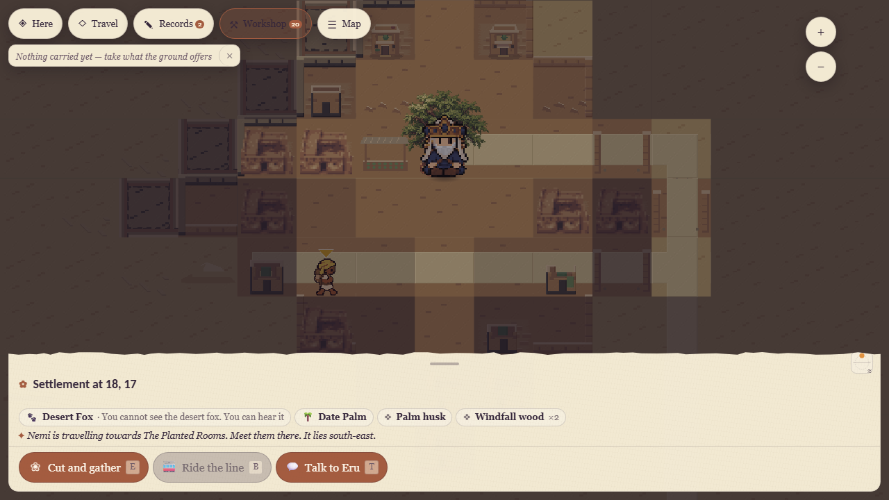
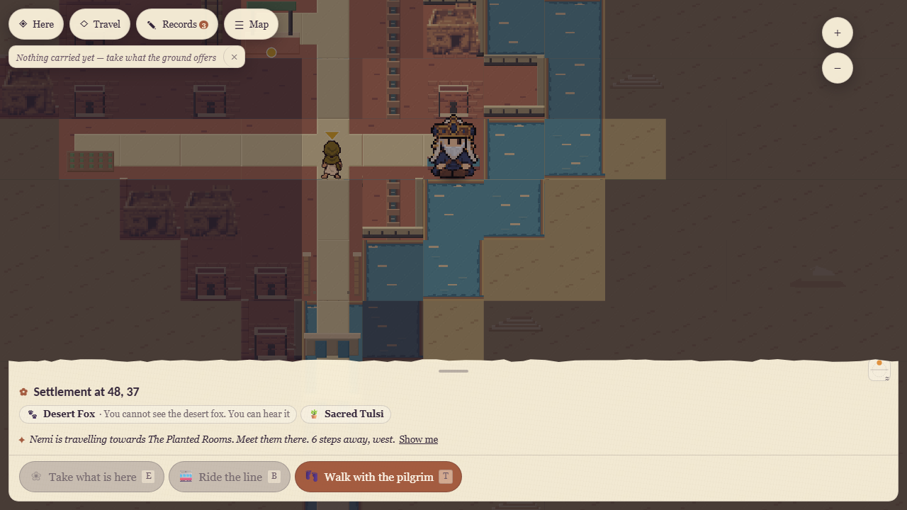

## Fifth batch: directional bridge reuse and contact depth

The owner flagged north–south causeway crossings over water. The district renderer used one
generic support frame and painted an ordinary road across it, irrespective of orientation.
Road crossings now reuse the existing `river-bridge.png` art and shared start/middle/end/single
span selection, with separate north–south and east–west frames. The planner lives in
`src/game/riverBridges.ts` and is used by both the established maps and the twin-city map;
the former export from `scenePlan.ts` remains available. Railway supports are excluded from
road-span adjacency. Ordinary road overlays and duplicate causeway markers do not cover decks.
No new bridge image was generated.

Continuing the simple-map depth pass, new houses now receive a small soft contact shadow
from the existing shadow texture, offset to their baseline and sorted beneath the building.
No shadow is added to NPCs or wildlife, and no full-screen lighting layer is introduced.

The original plan records the bridge correction. Desktop and touch-mobile captures show the
actual north–south crossing after walking north along it; both bridge orientations are covered
by placement checks. The existing tram crossing and nighttime behavior remain covered.

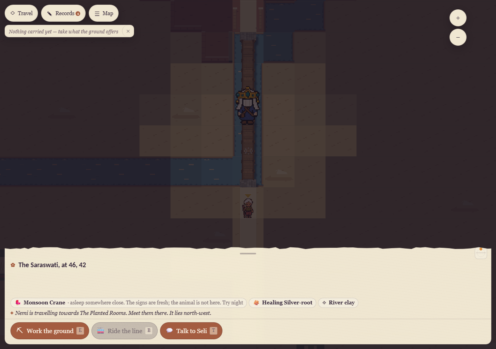
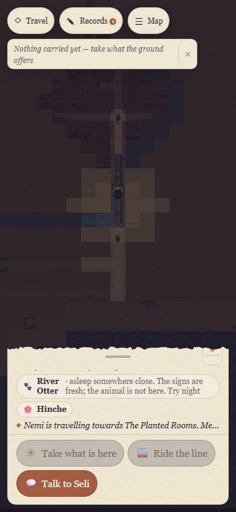

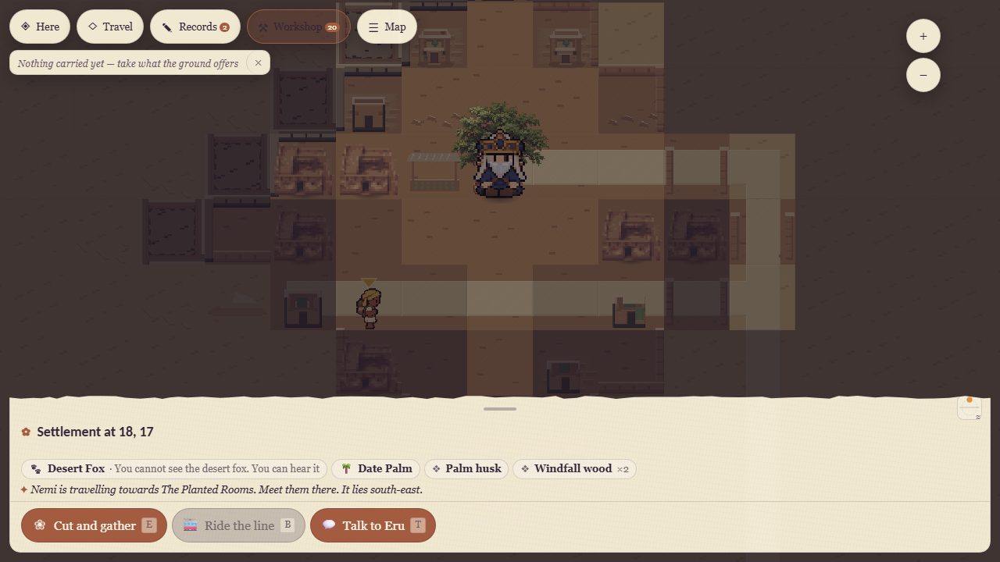

Verification for this batch: typecheck, all 3,587 unit tests, nine targeted browser checks
(two bridge viewport cases, three transport/diary cases and four art cases), production build
and bundle budget passed. The app remains 212.9 KB gzipped against the 220 KB budget.
Intel UHD/Direct3D11 frame-pacing checks with the bridge and house shadows applied remained
around 6.9–7.0 ms median while standing/walking in the two city views, with no page errors.
The display-paced measurement caveat in the previous batch still applies.

## Sixth batch: city environment composition phase

This phase groups residential space and working areas while retaining the simple NES map
direction. Fixed residential bands replace random house-density decisions; the seed chooses
which accepted house art occupies each eligible lot. Civic centres, routes, drainage and
authored work areas remain open. Geometry, POI positions and saved state are unchanged.

`src/game/twinEnvironment.ts` composes pottery storage, clay/brick work, reed shade,
landing timber, wells, terrace steps and planted courts relative to the actual POI anchors.
Every placement checks terrain, road/rail exclusion and other POI anchors. Reserved work
areas are cleared before houses are placed. Root strips require adjacent water.

The new `environment-nes.png` atlas is built by `node tools/build-twin-environment.js`:
32-pixel logical cells enlarged four times, broad shapes and a small palette, without fine
material texture. No image-generation calls or new detailed silhouettes were needed.
Water-side bank masks use four alpha steps to suggest depth; wetland edges remain soft
and bridge decks are excluded. All gradients stay on the water side of the bank.

At phase-end verification, the full unit run passed 3,588 cases with one obsolete random-house
count expectation failing. It was replaced with checks for frontage on both sides of each
city centre. The 12 affected city/environment cases then passed. All nine targeted browser
cases passed, including desktop/mobile bridge walking, art loading and tram behavior.
Two well offsets landing on roads were corrected and the city captures refreshed afterward.
The original full browser suite has not been run.

Final production build and bundle check passed at 213.4 KB gzipped for the app against the
unchanged 220 KB budget. The 6,852-byte environment atlas reproduced byte-for-byte. Phase-end
Intel UHD/Direct3D11 samples remained around 6.9 ms median standing and walking, with no page
errors; the existing display-paced measurement limitations still apply.
[Environment frame samples](images/twins/art-review/environment-performance.json).

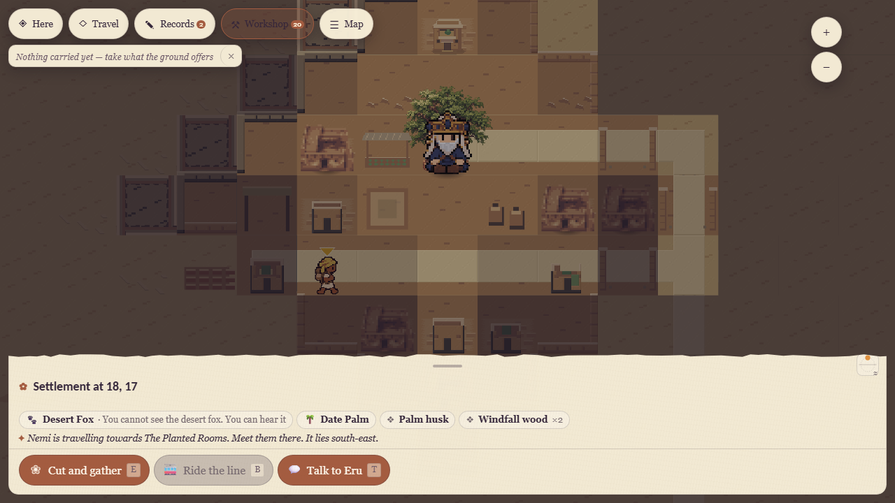
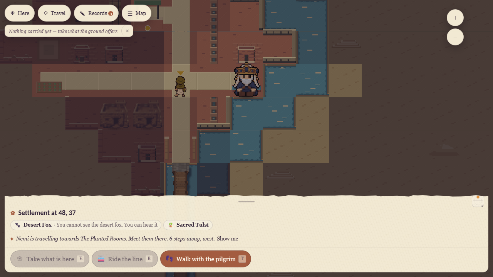

This completes the current city-environment composition phase. Seasonal variants, richer
tram-terminal motion and further NPC/event paintings remain separate work in the original plan.

## Publication batch and remaining scope

The owner requested completing the practical batch before any further testing, then committing
and pushing it for pipeline verification. No additional local test cycle was run after that
instruction. Earlier results above describe earlier revisions, not a claim that the final head
has passed CI.

The terminal turnaround now runs on elapsed loop time rather than delayed callbacks: a brief
halt, two planted directional steps and a neutral departure-ready rest over 600 ms. It reuses
the accepted four-direction sheet, keeps the platform position fixed, cancels when another ride
starts and restores player control immediately. It does not add independent neck, harness or
handler animation. Pipeline browser coverage must verify the final integration.

Completed in this branch: preferred painted-art lookup and fallbacks; one portrait, one place
painting and one event painting; the accepted neem landmark; two simplified city house variants;
material aprons and drainage scenery; shared directional bridge decks; house contact shadows;
authored house lots and work areas; eight simple environmental accents; water-side bank-depth
gradients; the short terminal sequence; reproducible source/build inputs and review captures.

Still open in the original programme: nine additional portraits, seventeen event paintings,
fourteen place views, named walking sheets, seasonal variants and bespoke wildlife/tram poses.
These need dedicated art work and review. The programme is not represented as fully complete.
Future map additions must remain simple 8-bit NES style; rich off-map paintings remain allowed.

## Pilot generation prompts (source history)

Built-in image generation was used for all four sources. The exact prompts follow.

### Event: assets/source/events/happening_twin_courtyard-painted.png

```text
Use case: illustration-story. Asset type: production game event painting, landscape 4:3, for South of Tethys. Paint 'A Courtyard Worth Shading': Nemi the courtyard gardener and Eru the earthen mason quietly show a travelling naturalist where an ochre mud-plaster wall repair stops short of a mature neem tree's roots. Ancient invented South Asian river-valley town Harappa; humble courtyard compounds, water jars, reed shade, worn brick thresholds. Three ordinary fully clothed working adults, no royalty or jewellery, undyed cloth, muted green wrap for gardener, dusty ochre wrap for mason. The naturalist carries a field notebook. Visible open root ring and loose earth beneath the tree, nobody treads on roots. Watercolor and gouache field-notebook illustration on warm off-cream paper, fine ink contours, visible pigment granulation, softly modelled faces and materials, atmospheric background, quiet warm daylight. A composed narrative with foreground roots/jars, middle-ground people and repaired wall, distant low roofs. No pixel art, no photographic effects, no modern objects, no text, frame, logo, signature or watermark. Fill canvas edge to edge.
```

### Portrait: assets/source/portraits/portrait-twin-mason-painted.png

```text
Use case: illustration-story. Asset type: square 1024x1024 game NPC portrait, Eru the earthen mason in Harappa, invented ancient South Asia. Ordinary middle-aged working man with sun-browned skin, dark hair tied back, short beard, observant calm face, fully clothed in plain undyed linen shoulder wrap with dusty ochre scarf. Head and shoulders only, three-quarter view looking down toward work off-frame, hint of wooden plaster float at bottom edge. Style: watercolor and fine ink naturalist field notebook, visible brush strokes and pigment granulation, softly modelled face, muted warm earth colours, matte off-cream paper background with a few strokes suggesting worn ochre plaster and neem leaves. Not a leader or sage, no jewelry, headdress or insignia. Face fills upper half; uncluttered silhouette remains readable at 40 pixels. No text, border, logo, signature, watermark, pixel art, photography, 3D or lens blur. Calm unposed working person.
```

### Place: assets/source/places/poi_harappa_court-painted.png

```text
Use case: illustration-story. Asset type: game place view for Harappa's Shaded Courtyard, wide landscape, composed for a 16:7 crop. Watercolour and fine ink naturalist notebook illustration on warm cream paper, visible brush strokes and pigment pooling, not photographic. A mature spreading neem shades terracotta water jars in a humble ancient South Asian earthen courtyard. Ochre mud-plaster walls visibly patched AROUND exposed roots; leave a generous ring of loose soil with roots undisturbed. Low courtyard houses with flat parapets, worn brick thresholds, reed shade canopy, one modest work bench with plaster tools, woven baskets. Tree and jars in the central horizontal band, several depth planes, partial background roofs and pale warm sky. Human scale, quiet inhabited place, no people necessary. Muted ochre, olive green foliage and warm plum-brown shadows; gentle afternoon sunlight from upper left; green reflected light in shade. No modern objects, monumental temple, text, border, caption, signature, logo, watermark, pixel art, lens blur or 3D render. Fill the frame edge to edge.
```

### Neem: assets/source/twins/harappa-neem.png

```text
Use case: stylized-concept. Asset type: one production top-down RPG environment sprite of a mature neem tree. Single broad spreading neem, exposed gnarled roots carefully encircled by a low broken ochre earthen curb, three terracotta water jars near trunk. Camera is elevated three-quarter top-down SNES RPG projection, see canopy tops and front of trunk, not isometric diamond. Crisp detailed 16-bit pixel art, coherent pixel clusters, muted olive and sage foliage with 4-5 stepped tones, cream upper-left highlights, plum-brown branch and root shadows, ochre clay with chipped surfaces. Leaf canopy irregular, fine paired leaflets represented by small deliberate clusters, branching trunk visible below it, believable roots, no palm fronds. Wide canopy above a narrow base. Tree fills image with transparent padding all sides, entire silhouette visible, rooted at bottom centre. True transparent background, no landscape, ground tile, horizon, text, grid, caption, guide, logo, signature or watermark. Quiet ancient South Asian courtyard tree, no hanging fantasy ornaments. Produce one object only.
```
